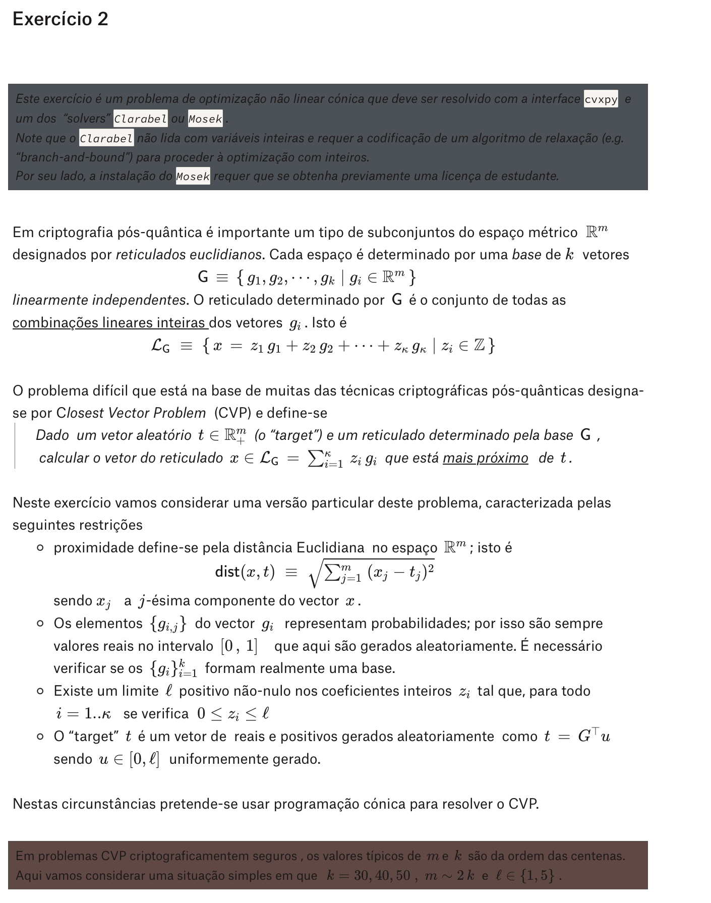

# Chat (1): CVP notebook exercise goal

Transcrição da sessão do Claude Code associada ao notebook [`cvp_solver.py`](cvp_solver.py).

| | |
|---|---|
| **Sessão** | CVP notebook exercise goal |
| **Associada a** | visão geral do problema (discussão do enunciado, sem alterações ao notebook) |
| **Ferramenta** | Claude Code 2.1.309, aplicação desktop |
| **Modelo** | Claude Opus 5.5 (`claude-opus-5-5`) |
| **Início** | 2026-10-31 15:19 UTC |
| **Última atividade** | 2026-10-31 16:04 UTC |
| **Ligação original** | <https://claude.ai/code/cshk_01DTsGR1YdSfXM9Fj2AmJA1JY9qhE4nAatdLynLAZEaxaD> (exige sessão iniciada numa conta Claude paga) |

**Como foi obtida.** Exportada automaticamente do ficheiro local da sessão. Os pedidos do utilizador e o texto das respostas do Claude estão na íntegra. As ações do Claude (comandos, leituras, edições de código, navegação) estão nos blocos recolhidos, que abrem com um clique.

**O que foi omitido.** Instruções internas da aplicação, raciocínio interno do modelo, conteúdo das skills, lista de tarefas e capturas de ecrã. As saídas longas estão truncadas, com indicação das linhas omitidas, e os caminhos locais estão abreviados.

## Pedidos

1. [Is the goal of the exercise a notebook that solves the CVP? Correct me if I am wrong.](#pedido-1)
2. [Let me see if I understand what you mean and the goal of the exercise with concrete exampl…](#pedido-2)
3. [The desktop app couldn't upload my work for the move to the cloud. Please run exactly git…](#pedido-3)
4. [how do I write Latex in marimo's markdown?](#pedido-4)

---

## Pedido 1

### 👤 Utilizador · 2026-10-31 15:19 UTC

> Is the goal of the exercise a notebook that solves the CVP? Correct me if I am wrong.  
>
> https://www.dropbox.com/scl/fi/zjhnov3hwfn4996mrlkdx/Logica-Computacional-2026-2027-Trabalhos-Praticos.paper?dl=0&rlkey=q0ybva0afy60gqowkgaskjndf  
>
> The link above contains instructions regarding the course I am taking (Logica Computacional).  



### 🤖 Claude · 15:19 UTC

<details>
<summary>⌨️ <b>Bash</b>: List repo files and recent commit history</summary>

```bash
ls -la && echo "---" && git log --oneline -15 && echo "---" && git show --stat HEAD~1 HEAD | head -50 && echo "---" && find . -path ./.git -prune -o -type f -print | grep -v '.idea' | head -50
```

Saída:

```text
total 8
drwxr-xr-x@  9 user  staff   288 Oct 31 15:15 .
drwxr-xr-x@ 48 user  staff  1536 Oct 30 17:47 ..
drwxr-xr-x@ 13 user  staff   416 Oct 31 15:14 .git
drwxr-xr-x@  8 user  staff   256 Oct 31 15:13 .idea
drwxr-xr-x@  9 user  staff   288 Oct 30 17:47 TP1.1 - HORARIO
drwxr-xr-x@ 10 user  staff   320 Oct 30 17:47 TP1.2 - SUDOKU
drwxr-xr-x@  2 user  staff    64 Oct 31 15:14 TP2.2 - CVP
drwxr-xr-x@  3 user  staff    96 Oct 30 17:47 __marimo__
-rw-r--r--@  1 user  staff   186 Oct 30 17:47 requirements.txt
---
53c089e Terminado
b8db32f Terminado
216d06a add pdf
8e46c2e simplified version
874904b merge
6482532 XSudoku
725273e move horarios to a subfolder rather than @ root
27713a4 Merge branch 'main' into fabio
41063bc add links to AI chats
3c3d547 Quase finalizado
244bbdc write tests and scenarios
199de11 Começando o marimo
4939db8 Prototipo sudoku
ece12d9 Testes
0f60342 add times per subject ('disciplina')
---
commit b8db32fb80091471806cabf037a361b51e164856
Author: Fábio Henrique <[email omitido]>
Date:   Tue Oct 6 21:08:13 2026 +0100

    Terminado

 .../__marimo__/session/sudoku_marimo_nb.py.json    | 145 ++++++++-
 .../__pycache__/sudoku_csp.cpython-314.pyc         | Bin 9170 -> 9191 bytes
 .../sudoku_test.cpython-314-pytest-9.1.1.pyc       | Bin 18110 -> 11498 bytes
 .../__pycache__/sudoku_visual.cpython-314.pyc      | Bin 2285 -> 2285 bytes
 TP1.2 - SUDOKU/main.py                             |  11 +-
 TP1.2 - SUDOKU/sudoku_csp.py                       |   2 +-
 TP1.2 - SUDOKU/sudoku_marimo_nb.py                 | 342 +++++++++++++--------
… (saída truncada: 72 linhas omitidas)
```

</details>

<details>
<summary>⌨️ <b>Bash</b>: Show requirements and how past exercises were structured</summary>

```bash
cat requirements.txt && echo "--- enunciado sudoku (head) ---" && head -60 "TP1.2 - SUDOKU/sudoku_enunciado.py" && echo "--- marimo nb (head) ---" && head -40 "TP1.2 - SUDOKU/sudoku_marimo_nb.py" && echo "--- TP2.2 folder ---" && ls -la "TP2.2 - CVP"
```

Saída:

```text
# Python >= 3.14
# python -m venv .venv && .venv/bin/pip install -r requirements.txt
marimo>=0.25.0
ortools>=9.15
anywidget>=0.11.0
traitlets>=5.16
# TP1.2 tests (sudoku_test.py)
pytest
--- enunciado sudoku (head) ---
# /// script
# requires-python = ">=3.14"
# dependencies = [
#     "marimo>=0.24.2",
# ]
# ///

import marimo

__generated_with = "0.25.1"
app = marimo.App(width="medium")


@app.cell
def _():
    import marimo as mo

    return (mo,)


@app.cell(hide_code=True)
def _(mo):
    mo.md(r"""
    # Trabalho Prático: Sudoku Genérico como CSP

    ## Contexto

    O Sudoku clássico — uma grelha $n^2 \times n^2$ onde cada linha,
    cada coluna e cada bloco $n \times n$ tem de conter todos os
    valores de $1$ a $n^2$ sem repetições — é um exemplo canónico de
    **problema de satisfação de restrições (CSP)**: a "regra" é sempre
… (saída truncada: 74 linhas omitidas)
```

</details>

*Skill carregada: `anthropic-skills:built-in-browser` (conteúdo omitido)*

<details>
<summary>🌐 <b>preview_start</b>: https://www.dropbox.com/scl/fi/zjhnov3hwfn4996mrlkdx/Logica-Computacional-2026-2027-Trabalhos-Praticos.paper?dl=0&amp;rlkey=q0ybva0afy60gqowkgas</summary>

```json
{"url": "https://www.dropbox.com/scl/fi/zjhnov3hwfn4996mrlkdx/Logica-Computacional-2026-2027-Trabalhos-Praticos.paper?dl=0&rlkey=q0ybva0afy60gqowkgaskjndf"}
```

Saída:

```text
{
  "serverId": "preview-local_d51e2b8b-5a32-4534-acb4-e944fb0f4f8b",
  "tabId": "seed",
  "reused": false,
  "type": "browser",
  "navOk": true
}
Browser pane opened. Use serverId "preview-local_d51e2b8b-5a32-4534-acb4-e944fb0f4f8b" with read_page / computer / navigate.
```

</details>

<details>
<summary>🌐 <b>get_page_text</b>: seed</summary>

```json
{"tabId": "seed", "max_chars": 80000}
```

Saída:

```text
Title: Dropbox Paper
URL: https://www.dropbox.com/scl/fi/zjhnov3hwfn4996mrlkdx/Logica-Computacional-2026-2027-Trabalhos-Praticos.paper?dl=0&rlkey=REDACTED
Source element: <body>
---
Sign up
Sign in to Dropbox
​​Lógica Computacional 2026-2027 - Trabalhos Práticos
​
​Avaliação contínua
​​Os alunos participam na avaliação contínua integrados em grupos. A constituição dos vários grupos de trabalho é feita individualmente por cada aluno nesta folha de cálculo.
​​Cada grupo contém 2 alunos ou excepcionalmente 3. Nos grupos com 3 alunos, a nota do trabalho é penalizada em ​​
5
… (saída truncada: 640 linhas omitidas)
```

</details>

I've read the course page. Now I'm grabbing the link to the Exercise 3 document it references, then I'll answer.

<details>
<summary>🌐 <b>find</b>: Multiplicação</summary>

```json
{"query": "Multiplicação", "tabId": "seed"}
```

Saída:

```text
Found 2 match(es) for "Multiplicação":
- generic "Lógica Computacional: Multiplicação de Inteiros" [ref_481]
- generic "Flow Automaton” como modelo do programa imperativo que calcula a multiplicação de inteiros positiv.." [ref_484]
```

</details>

<details>
<summary>🌐 <b>javascript_tool</b>: javascript_exec</summary>

```javascript
Array.from(document.querySelectorAll('a')).filter(a => /Multiplica|enunciado|template|aqui/i.test(a.textContent) || /Multiplica/i.test(a.href)).map(a => ({text: a.textContent.trim().slice(0,80), href: a.href}))
```

Saída:

```text
[
  {
    "href": "https://www.dropbox.com/scl/fo/afl6fih8454k98dpb68ag/AOO7d-9HD626-Aj13ZoXKso?rlkey=amecsyh3kd0bdhrc2pbbqa71x&st=qgf45fmr&dl=0",
    "text": "aqui"
  },
  {
    "href": "https://www.dropbox.com/scl/fi/kh7gzncahdup2lxs4t4js/TP1.1.zip?rlkey=d1b62tm4r6t7vyqbm8nkpy3ig&st=rthtisj1&dl=0",
    "text": "template"
  },
  {
    "href": "https://www.dropbox.com/scl/fi/kh7gzncahdup2lxs4t4js/TP1.1.zip?rlkey=d1b62tm4r6t7vyqbm8nkpy3ig&st=rthtisj1&dl=0",
    "text": "aqui"
  },
  {
    "href": "https://www.dropbox.com/scl/fo/jv4416xc3qb0p2vma64kr/AIOgSg3s51OOHMz7Wy2gSfg?rlkey=9h0bvr4l6x0krav1w015wcn7g&st=32hfddn1&dl=0",
    "text": "Ver enunciado aqui"
  },
  {
    "href": "https://paper.dropbox.com/doc/n1G7pMihg2yJrMswfpBxr",
    "text": "+Lógica Computacional: Multiplicação de Inteiros"
  }
]

(captured at origin https://dropbox.com)
```

</details>

<details>
<summary>🧵 <b>Proposta de nova sessão</b>: TP2 Exercise 3: Z3 SFOTS for integer multiplication</summary>

```text
Build the Marimo notebook for Exercise 3 of TP2 (Lógica Computacional 2026-2027) in a new folder `TP2.3 - MULTIPLICACAO/` at the repo root.

First read the statement in the built-in browser:
- Course page, section "Trabalho Prático 2" → "Exercício 3", plus the general rules at the top: https://www.dropbox.com/scl/fi/zjhnov3hwfn4996mrlkdx/Logica-Computacional-2026-2027-Trabalhos-Praticos.paper?dl=0&rlkey=q0ybva0afy60gqowkgaskjndf
- The document it references, "Lógica Computacional: Multiplicação de Inteiros", which models an imperative program that multiplies positive integers (represented as bit vectors) as a Control Flow Automaton: https://paper.dropbox.com/doc/n1G7pMihg2yJrMswfpBxr

The exercise asks for (paraphrased):
1. An SFOTS in Z3 using BitVecs of size n that describes that automaton: identify and encode the variables, the initial state, the transition relation and the error state.
2. Using k-induction, check whether x*y + z = a*b is an invariant.
3. Adding (a < 2^(n/2)) ∧ (b < 2^(n/2)) to the initial state, use k-induction to prove safety, i.e. that the error state is unreachable.
4. Encode the liveness property that the program terminates for any initial a and b, and prove it holds in the SFOTS (e.g. with a variant that strictly decreases on every non-final transition, unless the course document prescribes another method).

Notebook requirements from the course rules: describe the problem and the approach; show the code; include realistic tests of correctness, efficiency and scaling (e.g. several values of n, with timings); mark every LLM-generated piece of code with a comment, reference it in the text, and leave a placeholder where the user will paste the link to the LLM chat. Follow the style of `TP1.2 - SUDOKU/sudoku_marimo_nb.py` (Marimo, markdown cells in Portuguese) and declare `z3-solver` in the notebook's inline `# /// script` dependencies.

Only create or edit files inside `TP2.3 - MULTIPLICACAO/`. Don't edit `requirements.txt` (list any dependency it needs in your report instead), commit nothing, and don't switch branches: this checkout is shared with other work.

Done = the notebook runs top to bottom in Marimo without errors and answers all four items with the Z3 output shown (the invariant holds or a counterexample, the safety proof, the termination proof). Report the notebook path and the result of each item.
```

Saída:

```text
Proposed "TP2 Exercise 3: Z3 SFOTS for integer multiplication" (task_id: task_a6fcdcf4). The user sees a card and nothing runs until they start it — with a click, or by telling you (then call start_session with proposal_id task_a6fcdcf4 and nothing else). It expires in 7 days unless started; dismiss_task withdraws it sooner if it goes stale. Don't wait for it and don't repeat the introduction; carry on with what you were doing.
```

</details>

> **Resumo mostrado na aplicação:** Yes, Exercise 2's goal is a notebook that solves a bounded CVP, but it has to use conic programming via cvxpy with Clarabel or Mosek. TP2 also requires Exercise 3. The written part is due 23:59 on 3 Nov, and nothing in the repo has changed yet.
>
> **Pergunta:** Which solver route should the CVP notebook take?
>
> **Opções:** Clarabel + B&B · Mosek

You're mostly right: Exercise 2's deliverable is a notebook that solves the CVP. But the course page adds three things the statement doesn't mention, and the statement limits what "solves" can mean.

**What the course page adds**

- **Exercise 2 is only half of TP2.** The page says "Resolve um dos exercícios 1 ou 2 e o exercício 3".
  - You pick one of Exercise 1 (Game of Life) or Exercise 2 (CVP). Your `TP2.2 - CVP` folder covers that.
  - Exercise 3 is mandatory: a Z3 model (an SFOTS with BitVecs) of an integer-multiplication program. It needs k-induction proofs of an invariant and of safety, plus a proof that the program terminates.
  - Each problem gets its own notebook, so TP2 is two notebooks.
- **The deadline is close.** The written part is due by email to José Manuel Valença by 23:59 on Tuesday 3 Nov, three days from now. You send the executable notebooks plus a PDF of each, or make your GitHub repo public and send its link. The 30-minute orals are on 4–5 Nov and include running the code live.
- **The notebook is graded on more than the code.**
  - It has to explain the problem and your approach.
  - It needs realistic tests of correctness, efficiency and how the solution scales.
  - Any code an LLM wrote, including anything I write for you, must be marked in comments and in the report, with the chat link included.

**What "solves the CVP" means here**

- **Method:** the statement says it must be solved with `cvxpy` and either Clarabel or Mosek.
  - Mosek handles integer variables directly but needs a student license.
  - Clarabel can't handle integers, so you'd write the branch-and-bound yourself.
  - OR-Tools, brute force or LLL/Babai don't meet the brief as the main solver. They're fine as comparisons in your tests.
- **Model:** minimize ‖Gᵀz − t‖₂ subject to 0 ≤ zᵢ ≤ ℓ, with z integer. That's a mixed-integer second-order cone program, and the answer is the lattice vector x = Gᵀz.
- **Data and instances:**
  - G is random with entries in [0,1], and you must check that it really is a basis (rank k).
  - The target is t = Gᵀu, with u uniform in [0,ℓ]ᵏ.
  - Run k = 30, 40, 50 with m ≈ 2k and ℓ ∈ {1, 5}. That's six configurations to report.

**Worth noticing before you start:** u is inside the allowed box, so if you drop the integer requirement the best answer is exactly z = u, at distance 0. All the difficulty comes from requiring integers. Any branch-and-bound therefore starts with a lower bound of 0. Rounding u gives you a valid starting solution for free, and a baseline to beat.

**On the solver choice:**
- **Clarabel plus your own branch-and-bound** needs no license. It also gives you node and pruning counts for the scaling tests.
- **Mosek** means less code, but you'd have to request and install the license yourself.

I've also left a card that would build Exercise 3 in its own session, if you want that running in parallel.

## Pedido 2

### 👤 Utilizador · 2026-10-31 15:37 UTC

> Let me see if I understand what you mean and the goal of the exercise with concrete examples:  
>
> G is a subset type, not a subset itself. So, a matching subset of type G is, for example with k = 2 and m = 2: {(0, 1), (1, 0)}, and the reticulate type for the subset in question includes all subsets {x = z_1(0, 1) + z_2(1, 0) | z_i in Z}.  
>
> And then, to the problem itself: would Reals^m_+ be R^2\\(0, 0) in the context of my previous example? Then, the problem is: find the x = (...) in Reticulate of G that is closest to t.  
>
> How close am I to describing the actual problem?  

### 🤖 Claude · 15:39 UTC

You're close on the problem itself, but three details need fixing.

**1. G is one specific set of vectors, not a type.** The notation {g₁, …, gₖ | gᵢ ∈ ℝᵐ} lists k vectors and says each one is in ℝᵐ.
- What the exercise fixes is how to build G: k vectors, m entries each, every entry in [0,1]. Each run then has one specific G.
- Your {(0,1), (1,0)} is a valid G for k = m = 2.
- You have to check that the G you generate really is a basis. {(1,1), (2,2)} wouldn't be, because the second vector is just twice the first.
- In code, G is a k×m array whose rows are the gᵢ.
- One difference from your example: the exercise uses m ≈ 2k, so the k vectors only cover a k-dimensional part of ℝᵐ, not all of it. For building intuition, k = m = 2 is fine.

**2. The lattice is a set of points, not a set of subsets.** For your G, L_G = {z₁(0,1) + z₂(1,0) | zᵢ ∈ ℤ} = {(z₂, z₁) | zᵢ ∈ ℤ}. That's every point with integer coordinates, i.e. ℤ². The usual English word for *reticulado* is *lattice*.

**3. ℝᵐ₊ isn't ℝ² minus the origin.** It's the vectors whose components are all ≥ 0. For m = 2 that's the first quadrant, so a point like (−1, 3) is excluded. You don't have to enforce this yourself. Since t = Gᵀu, G's entries are in [0,1] and u ≥ 0, t's components come out positive automatically.

**The problem:** yes, find the x in L_G closest to t. The exercise adds two things:
- Each zᵢ is limited to {0, 1, …, ℓ}, so there are finitely many candidates: (ℓ+1)ᵏ of them.
- What you actually search for is z. Once you have z, x = z₁g₁ + … + zₖgₖ follows.

**Why your example feels easy and the exercise isn't.** Your basis is two perpendicular unit vectors, so the answer is just t with each coordinate rounded. The exercise's vectors all have entries in [0,1], so they all point in roughly the same diagonal direction. With vectors like that, rounding can give the wrong answer.

Here's a small example: k = m = 2, ℓ = 1, g₁ = (0.9, 0.3), g₂ = (0.6, 0.4), u = (0.6, 0.6). That gives t = 0.6·g₁ + 0.6·g₂ = (0.9, 0.42).

| z | x = z₁g₁ + z₂g₂ | distance to t |
|---|---|---|
| (0, 0) | (0, 0) | 0.99 |
| (1, 0) | (0.9, 0.3) | **0.12** (closest) |
| (0, 1) | (0.6, 0.4) | 0.30 |
| (1, 1) | (1.5, 0.7) | 0.66 (what rounding u gives) |

Rounding u = (0.6, 0.6) gives z = (1, 1). The closest lattice point is z = (1, 0), more than five times nearer.

With four candidates you can just check them all. At k = 50 there are 2⁵⁰ ≈ 10¹⁵ candidates for ℓ = 1, and 6⁵⁰ ≈ 10³⁹ for ℓ = 5. That's why the exercise wants a solver, which searches with branch-and-bound, instead of checking every candidate or rounding.

## Pedido 3

### 👤 Utilizador · 2026-10-31 16:00 UTC

> The desktop app couldn't upload my work for the move to the cloud. Please run exactly `git push --no-follow-tags https://github.com/amarogu/logica_computacional_tps.git +5ddc3b93476bad76e87a9ca8b4096978785110eb:refs/claude-teleport/5570f4b280c30335` from the repository root and tell me whether it succeeded. Don't change, commit or push anything else.  

### 🤖 Claude · 16:00 UTC

<details>
<summary>⌨️ <b>Bash</b>: Push the requested commit to the cloud-transfer ref on GitHub</summary>

```bash
git push --no-follow-tags https://github.com/amarogu/logica_computacional_tps.git +5ddc3b93476bad76e87a9ca8b4096978785110eb:refs/claude-teleport/5570f4b280c30335
```

Saída:

```text
To https://github.com/amarogu/logica_computacional_tps.git
 * [new reference]   5ddc3b93476bad76e87a9ca8b4096978785110eb -> refs/claude-teleport/5570f4b280c30335
```

</details>

> **Resumo mostrado na aplicação:** The push succeeded: commit 5ddc3b9 is now on GitHub as the new ref refs/claude-teleport/5570f4b280c30335. Nothing else was changed, committed or pushed.

The push succeeded. GitHub reported `* [new reference]`, so commit `5ddc3b93476bad76e87a9ca8b4096978785110eb` is now on `amarogu/logica_computacional_tps` under `refs/claude-teleport/5570f4b280c30335`. I ran only that one command and didn't change, commit or push anything else.

## Pedido 4

### 👤 Utilizador · 2026-10-31 16:04 UTC

> how do I write Latex in marimo's markdown?  

### 🤖 Claude · 16:04 UTC

Inside `mo.md(...)`, put LaTeX between `$...$` for inline math or `$$...$$` for a displayed equation. marimo renders it with KaTeX. Your Sudoku statement already does this, e.g. `$n^2 \times n^2$` in [sudoku_enunciado.py](../TP1.2%20-%20SUDOKU/sudoku_enunciado.py#L23).

```python
@app.cell(hide_code=True)
def _(mo):
    mo.md(r"""
    O reticulado gerado por $G$ é

    $$
    \mathcal{L}_G = \Big\{\, x = \sum_{i=1}^{k} z_i\, g_i \;\Big|\; z_i \in \mathbb{Z} \,\Big\}
    $$

    e queremos minimizar $\lVert G^\top z - t \rVert_2$ com $0 \le z_i \le \ell$.
    """)
    return
```

Two things to watch:

- **Always use a raw string (`r"""..."""`).** Without the `r`, Python reads the backslashes as escape codes: `\times` becomes a tab followed by "imes", and `\frac` becomes a form feed followed by "rac". Markdown cells you create from the editor's "Markdown" button are saved as `mo.md(r"""...""")` automatically, so you can type LaTeX straight into them.
- **To insert Python values, use `rf"""..."""` and double the LaTeX braces.** In an f-string, `{k}` is replaced by the value of `k`, so braces you want LaTeX to see must be written as `{{ }}`:

  ```python
  mo.md(rf"""
  Para $k = {k}$, a distância mínima foi $\lVert G^\top z - t \rVert_2 = {dist:.4f}$,
  entre $(\ell+1)^{{k}}$ candidatos.
  """)
  ```

`\(...\)` and `\[...\]` also work, if you prefer them to dollar signs.
